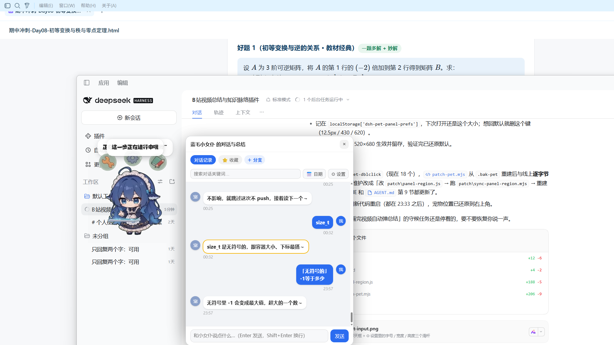
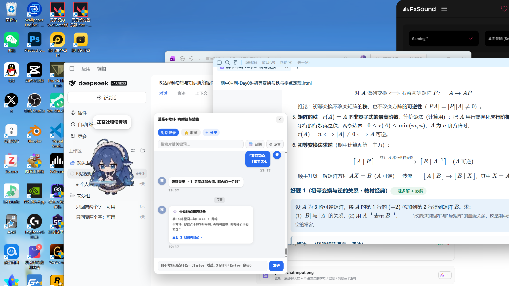
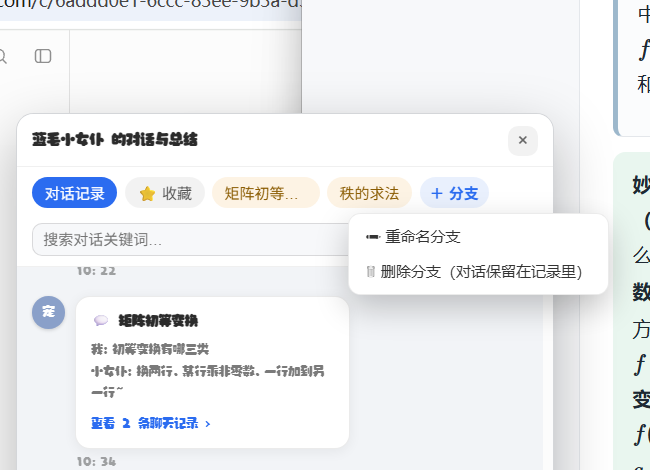

# 宠物聊天（dsh-pet-chat）

DeepSeek Harness 桌面宠物，**基于 [dsh-pet](https://github.com/PC2005-cloud/dsh-pet)（MIT）的二次修改版**。
原项目的动画、素材、桌面窗口全部保留，这里多了「能好好聊天」的一层。

## 相比原版多了什么

- **QQ 风格对话面板**：双击小女仆打开，气泡 + 头像 + 日期分隔，可在「对话记录 / ⭐ 收藏 / 分支 / ＋」之间切换。
- **分支对话**：点「＋ 分支」开一个小支线，聊完点「合并到主对话」，以**合并转发卡片**落进对话记录；分支标签右键可重命名/删除（删了只是撤掉卡片，那几句回到主记录，不丢内容）。
- **面板停靠 + 八向缩放**：面板固定在小女仆右侧不挡她；边缘/四角拖拽改大小，设置里还有字体、字重、字号、宽度、高度、双方头像。
- **省 token**：默认关掉配图清单、记忆轮数降到 2；寒暄类短句走本地规则表（0 token），只有真问题才发给模型。
- **长按小女仆可拖动窗口**，面板跟窗一起走，相对位置不乱。

## 长什么样







## 安装

从 GitHub 直接装（**不需要 npm**，推荐）：

```bash
dsh plugin add github:lintwosix-beep/dsh-pet-chat
```

如果之后也发到了 npm，可以用短名字：

```bash
dsh plugin add dsh-pet-chat
```

或在 **插件 → 发现** 里搜索「宠物聊天」。

> 与原版 `dsh-pet` **不要同时装**：两者共用 `~/.dsh/dsh-pet` 数据目录，会抢同一份记忆与同一个桌面窗口。装之前先卸掉原版。

## 致谢

- 原项目：[PC2005-cloud/dsh-pet](https://github.com/PC2005-cloud/dsh-pet)（MIT，动画、素材、桌面 Helper 均来自它）
- 字体与表情包素材的版权随原仓库，未做改动
